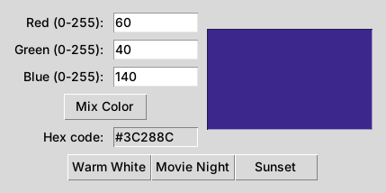
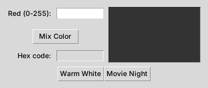
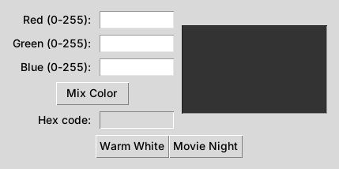
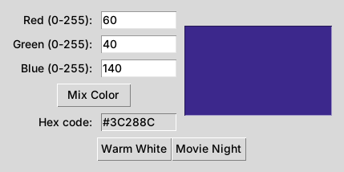
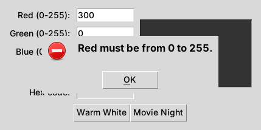

# LED Color Mixer

Build a small desktop app that mixes red, green, and blue light into a color, shows its hex code,
and saves "scenes" you can load with one click. Along the way you will learn how a Python GUI
waits for you, listens for clicks, and talks to the boxes on screen.



## At a glance

| | |
|---|---|
| **Schedule topic** | Week 9: Murach's Python Programming, Section 4, Part B. GUI programming |
| **Textbook** | *Murach's Python Programming*, 2nd ed., Chapter 18, "How to build a GUI program," pages 511-533 |
| **Time** | About 15 minutes |
| **You will practice** | Root windows and the event loop, labels and entry boxes, `StringVar`, grid layout, button callbacks, read-only fields, and message boxes |
| **Python** | 3.10 or newer. No packages to install (`tkinter` comes with Python) |

## Why this is worth learning

So far our programs run in the terminal: they ask a question, wait for typing, and print an
answer. Most software people actually use has a window instead. A GUI lets someone use your
program without knowing anything about the terminal.

This app also mirrors real tools:

- **Smart lighting apps** like Philips Hue and Govee store colors as three numbers from 0 to 255,
  one each for red, green, and blue. On a microcontroller such as an Arduino, those same three
  numbers set how bright each color of an LED strip glows.
- **Dashboards and design tools** like Power BI, Tableau, matplotlib, Canva, and CSS use **hex
  codes** (`#FFA957`) for exact colors. Companies define their brand colors this way.
- **The pattern carries over:** type values, check them, and update the screen. That same loop
  runs every form, settings panel, and dashboard filter you have ever used.

## Three key ideas

**1. A GUI program waits instead of finishing.** A console program runs from the top to the
bottom and stops. A GUI program sets up its window once, then calls `root.mainloop()`, which
shows the window and waits for things to happen, like a click. Your code only runs again when
the window "calls you back." (Figure 18-1, pages 512-513.)

**2. Callbacks connect a button to your code.** When you create a button, `command=mix` tells
it which function to run *later*, when someone clicks it. That function is called a **callback**
or **event handler**. (Figure 18-3, pages 516-517.)

**3. `StringVar` is the bridge between a box and your code.** Each entry box is bound to a
`StringVar`. Your code uses `.get()` to read what the user typed and `.set()` to write into the
box. Scene buttons use `.set()` to fill the boxes for you. (Figure 18-4, pages 518-519.)

## Before you start

1. **Python 3.10 or newer**, and **VS Code** (or any editor plus a terminal).
2. **Check that tkinter works.** In a terminal, run:

   | Windows | Mac |
   |---|---|
   | `python -m tkinter` | `python3 -m tkinter` |

   A small test window should pop up. Close it and continue. If you get an error, see
   [Troubleshooting](#troubleshooting).

## Setup

1. **Clone the repository.** Open a terminal in the folder where you keep class work, then run:

   ```text
   git clone https://github.com/YOUR-USERNAME/led-color-mixer.git
   ```

   This creates a `led-color-mixer` folder with everything inside. No Git? On the repository page,
   click **Code > Download ZIP** and unzip it instead.
2. In VS Code, choose **File > Open Folder** and open the `led-color-mixer` folder.
3. Open a terminal with **Terminal > New Terminal**. It should already be in `led-color-mixer`.
4. Open `code/led_mixer_starter.py`. This is the only file you will edit.

**Run command** (use it after every TODO):

| Windows | Mac |
|---|---|
| `python code/led_mixer_starter.py` | `python3 code/led_mixer_starter.py` |

**Stuck?** The finished app is in `code/led_mixer_finished.py`. Try each step yourself first,
then use it to compare.

## The activity

Work through the TODOs in order. Each one ends with a **Checkpoint** that tells you what you
should see.

### TODO 1: Make the window appear (pages 512-513)

Run the starter **before changing anything**. What happens?

Nothing. The program starts, builds the window in memory, and then exits right away. This is
the most common GUI mistake, and the book calls it out on page 512: without `mainloop()`, the
program never starts waiting for events.

Scroll to the bottom of the file and add this as the **very last line**:

```python
root.mainloop()
```

> **Checkpoint 1:** A window titled "LED Color Mixer" appears with a Red box, a Mix Color button,
> a Hex code box, a dark swatch, and two scene buttons. Nothing works yet.



### TODO 2: Add the Green and Blue rows (pages 518-521)

Find the Red row. It is a `Label` in column 0 and an `Entry` in column 1, both in row 0:

```python
ttk.Label(frame, text="Red (0-255):").grid(column=0, row=0, sticky=tk.E)
ttk.Entry(frame, width=10, textvariable=red_text).grid(
    column=1, row=0, sticky=tk.W)
```

Copy it twice, right below, for **Green in row 1** and **Blue in row 2**. Change three things each
time: the label text, the `StringVar` (`green_text`, `blue_text`), and the row number.

> **Checkpoint 2:** Three labeled boxes, lined up in a neat column.



### TODO 3: Make Mix Color work (pages 516-519)

Find the `mix()` function near the top and replace `pass` with:

```python
red = int(red_text.get())
green = int(green_text.get())
blue = int(blue_text.get())

code = to_hex(red, green, blue)
swatch.config(bg=code)
hex_text.set(code)
```

Then find the Mix Color button and connect it to your callback:

```python
ttk.Button(frame, text="Mix Color", command=mix).grid(column=0, row=3, columnspan=2)
```

Two things are new here:

- `swatch.config(bg=code)` changes a widget **after** it was created. The book does not cover
  `config()`, but it works on almost every widget.
- The swatch is a `tk.Label`, not a `ttk.Label`. On Mac, `ttk` widgets ignore background colors,
  so the plain `tk` version is used for anything that needs to change color.

> **Checkpoint 3:** Type `0`, `200`, `255` and click Mix Color. The swatch turns sky blue and the
> Hex code box shows `#00C8FF`. Click **Movie Night**: the boxes fill in by themselves and the
> swatch turns deep purple (`#3C288C`).



**Now try to break it.** Type `abc` in the Red box and click Mix Color. A red error appears in
the terminal (`ValueError`), and the color does not change. Users will type anything, so we need
to catch that.

### TODO 4: Catch bad input with message boxes (pages 524-529)

Find `get_channel()`. It already tries to convert the text with `int()`, just like the book's
`get_int()` method on page 529. Fill in the two error boxes:

```python
messagebox.showerror("Invalid value", f"{name} must be a whole number.")
```

```python
messagebox.showerror("Out of range", f"{name} must be from 0 to 255.")
```

Then, in `mix()`, swap each `int(...)` for `get_channel(...)` and stop early if any value failed:

```python
red = get_channel(red_text.get(), "Red")
green = get_channel(green_text.get(), "Green")
blue = get_channel(blue_text.get(), "Blue")

if red is None or green is None or blue is None:
    return
```

> **Checkpoint 4:** Type `300` in Red and click Mix Color. A pop-up says
> "Red must be from 0 to 255." Click OK. The color has not changed, and your typing is still
> there so you can fix it. Also try `abc`, `-1`, `12.5`, and an empty box.



### TODO 5: Add your own scene (your turn)

This step has no copy-and-paste answer. Look at how `warm_white()` and its button work, then add
a scene of your own: your room's lighting, a favorite team's color, anything.

You need two things:

1. **A function** near the other scenes (TODO 5a) that calls `load_scene()` with your three numbers.
2. **A button** in `scene_frame`, column 2 (TODO 5b), whose `command=` names your function.

Need ideas? Focus `(255, 249, 253)`, Sunset `(255, 94, 77)`, Ocean `(0, 180, 200)`,
Party `(255, 0, 180)`.

> **Checkpoint 5:** Your button appears next to Movie Night. Clicking it fills the three boxes
> and the swatch changes to your color.
> Example answer: `code/led_mixer_finished.py` (adds a Sunset scene)

## Common mistake: parentheses after a callback

```python
ttk.Button(scene_frame, text="Sunset", command=sunset())   # wrong
ttk.Button(scene_frame, text="Sunset", command=sunset)     # right
```

With parentheses, Python **runs** `sunset()` immediately, once, while it builds the window, and
hands the button its result (`None`). Your scene loads on startup and the button does nothing
when clicked. Without parentheses, you hand the button the **function itself** to run later.

A related mistake from TODO 1: any code placed **after** `root.mainloop()` will not run until the
window closes. Keep `mainloop()` as the last line.

## Check your understanding

Try to answer before opening each one.

<details>
<summary>1. You ran the starter and nothing appeared. Why, and what fixed it?</summary>

There was no `root.mainloop()`. Without the event loop, the program builds the window and exits.
Adding `mainloop()` as the last line shows the window and keeps it open, waiting for events.
</details>

<details>
<summary>2. What is the difference between <code>red_text.get()</code> and <code>red_text.set("255")</code>?</summary>

`.get()` reads whatever is in the Red box. `.set("255")` writes `255` into the box. Mix Color
reads; the scene buttons write.
</details>

<details>
<summary>3. Your new scene loads the moment the app opens, and clicking its button does nothing. What happened?</summary>

The button was created with `command=my_scene()` instead of `command=my_scene`. The parentheses
ran the function once at startup.
</details>

<details>
<summary>4. Why does <code>mix()</code> <code>return</code> early when a value is <code>None</code>?</summary>

`None` means that box failed validation and the user already saw an error box. Returning stops
`to_hex()` from crashing and leaves the old color on screen.
</details>

## Connections

- **Activity 4, Week 9 (Party Roster):** the same pattern, with a database behind it. Read the
  boxes in a callback, validate, then update what the window shows.
- **Homework 18-2 (MPG program):** uses the same tools. Labels and entries in a grid, a Calculate
  callback, a read-only result field, and a `get_float()` method like `get_channel()`.
- **What comes next in the book:** page 522 shows how to organize a GUI as a class that inherits
  `ttk.Frame`. Try turning this app into a `MixerFrame` class.

## Reflection

Take one minute and answer: **What is one thing about how a GUI program runs that is different
from the console programs we wrote earlier in the course?** And: **Where else have you seen this
"type, check, update" pattern in apps you use?**

## Troubleshooting

| What you see | What to try |
|---|---|
| The program ends immediately with no window | Add `root.mainloop()` as the last line (TODO 1). |
| `python` is not recognized (Windows) | Try `py code/led_mixer_starter.py`. |
| `python: command not found` (Mac) | Use `python3` instead of `python`. |
| `No module named '_tkinter'` (Mac, Homebrew Python) | Run `brew install python-tk`, or install Python from python.org, which includes tkinter. Do not run `pip install tkinter`. |
| A button does nothing | Check that its `command=` names the right function with **no parentheses**, and look for a red error in the terminal. |
| The swatch stays gray on Mac | Make sure the swatch is `tk.Label`, not `ttk.Label`. |
| `NameError` mentioning a variable | Check spelling. `green_text` and `greentext` are different names. |
| `IndentationError` | The lines inside a function must be indented the same amount (4 spaces). |

## Project structure

```text
led-color-mixer/
|-- README.md                       this guide
|-- .gitignore
|-- code/
|   |-- led_mixer_starter.py        the file you edit
|   `-- led_mixer_finished.py       the completed app, for comparing
`-- docs/
    |-- facilitator_notes.md        presenter run-of-show
    |-- peer_test_log.md            results from peer testing
    `-- images/                     expected-output screenshots
```

## Known limitations

- The app shows colors on screen only. It does not connect to real lights. Controlling an actual
  LED strip would need hardware and a library for Bluetooth or a serial connection.
- Scenes live in the code, so a new scene means a new function and button. Saving scenes to a file
  would be a natural next step.
- Screenshots were taken on Linux. Buttons and boxes look a little different on Windows and Mac,
  but the layout and behavior are the same.

## Sources and AI use

- **Textbook:** Urban, M., & Murach, J. (2021). *Murach's Python Programming* (2nd ed.). Mike
  Murach & Associates. Chapter 18, pages 511-533. The window setup, grid layout, and validation
  pattern follow figures 18-1 through 18-8.
- **Course materials:** activity structure and README style were informed by the course's
  Activity 4 (Party Roster) materials.
- **Color values:** the scene colors are approximations chosen for this activity, not
  manufacturer specifications.
- **AI assistance:** I used Claude (Anthropic) to brainstorm activity ideas, draft the starter and
  finished code, and draft this README. I verified the code against Chapter 18 and by running
  the starter and finished app at every step, including the invalid inputs listed in TODO 4, and confirmed each scene
  produces the hex code shown. Peer testing results and the changes I made afterward are in
  [docs/peer_test_log.md](docs/peer_test_log.md).
